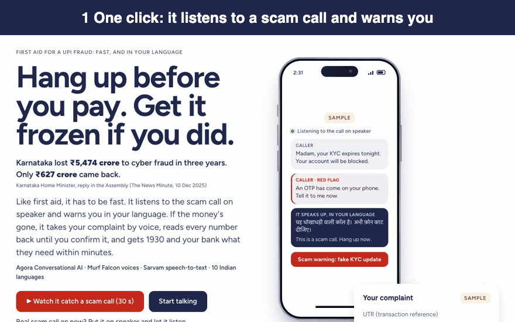
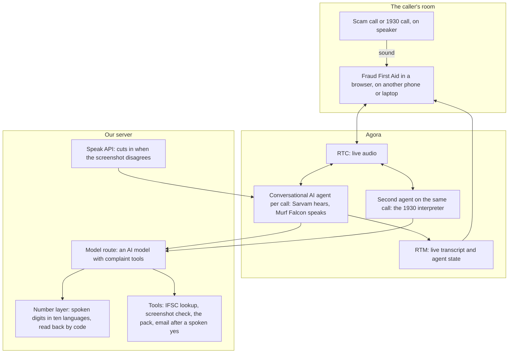
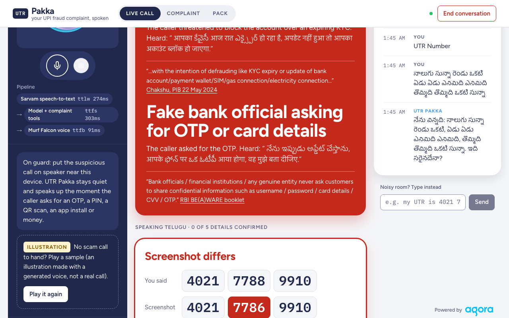

# Fraud First Aid

**Catches the scam on the call. Chases the money if it's gone.** First aid for a UPI fraud, and like first aid it has to be fast: the first hour decides whether the money can still be frozen. It listens to the scam call on speaker and warns you in your language, and if the money has gone it takes your complaint by voice with every number right and gets your bank and 1930, India's national cyber fraud helpline, what they need within minutes.

It's for the person on the phone when it happens: the parent who gets a "KYC" call, the senior citizens who lost ₹4,005 crore to cyber fraud in 2025 (Rajya Sabha reply, 5 Aug 2026), anyone who doesn't think in English in the first panicked hour. And when they call 1930, it speaks to the operator for them.

It runs on Agora's Conversational AI Engine because the job is a live, interruptible conversation with a frightened person: an agent per call with our own model route and tools, silent turns while it listens, Agora's speak API to cut in, a second agent on the same call as the 1930 interpreter, RTC for family to listen, and RTM for the live transcript and the agent's state. Sarvam hears ten Indian languages; Murf Falcon speaks them with Murf's own recommended Indian voices and reads every number back.

**Live: https://fraudfirstaid.vercel.app** · press **Watch it catch a scam call**: one click, no microphone, the warning in about 20 seconds. **Check it yourself: https://fraudfirstaid.vercel.app/proof**: try to fool the scam guard with your own lines, or say a UTR any way you like.



*The live app on 21 Nov 2026, sped up: the one-click scam catch, a complaint in Telugu with the UTR read back and checked against the payment screenshot, then the 1930 interpreter giving the operator the UTR in English. The voices, the operator's included, are generated sample clips (an illustration); the app and its answers are real.*

Proof, recomputed on every push from the results files in this repo:
- Back-test on public data (INDICA, scam calls machine-translated into Indian languages): warned on 198 of 200 scam conversations and on none of 200 legitimate ones, in Telugu, Hindi, Kannada, Tamil, Malayalam, Bengali, Gujarati and English. Keyword rules alone caught 16.
- Back-test on public data (ICFD-31k, synthetic scam calls, 2025): warned in 144 of 200 scam conversations it had never seen, and stayed quiet on 29 of 39 legitimate ones. The same AI model simply told to warn about scams warned on 199, but also on 33 of 39 legitimate calls.
- Back-test on public data (FLEURS read speech in Hindi, Telugu and Kannada, 2022): the exact numbers in 207 of 330 sentences. The speech-to-text alone: 114. In six more of our languages, 540 of 1,107 against 423.
- Our own break test (we tried to make it fail): 24 of 24 ordinary calls left alone.

[](.github/workflows/tests.yml) [](evidence/verify.py) · [technical report](docs/technical-report.md) · [system card: what it won't do, how it can fail, what it keeps](docs/SYSTEM_CARD.md)

Why it matters in Karnataka: the state lost ₹5,473.97 crore to cyber fraud in three years and recovered ₹627 crore, 11.5% (Home Minister's reply in the Assembly, [The News Minute, 10 Dec 2025](https://www.thenewsminute.com/karnataka/karnataka-residents-lost-rs-5474-crore-to-cyber-fraud-only-115-recovered)). Money comes back when 1930 hears fast and exact: a 79-year-old in Mangaluru got ₹17 lakh back and a 44-year-old in Bengaluru ₹14 lakh, both because 1930 heard within hours ([cases below](#why-this-matters)).

## What it does for you

1. **During the scam**, it listens to the call on speaker and tells you to hang up before you lose anything. If the caller names a UPI ID from an earlier complaint, it says so at once. Every line the scammer said is kept, with the red flags marked and any OTP or PIN blanked, as evidence for 1930.
2. **If the money's gone**, it takes your complaint by voice and gets every detail right. Each number is read back in groups of four until you confirm it, then checked against your payment screenshot.
3. **It acts**: it finds your bank and branch from the IFSC code, your bank's own fraud line, and the date your bank must hear by for zero liability (RBI: 3 working days).
4. **It hands you everything**: the 1930 script in your language, an English card for the 1930 operator, the bank letter, three calendar reminders (the last on day 30: did your bank reply?) and an RBI Ombudsman complaint ready for that day. It emails the pack once you say yes. One tap brings a family member onto the call: they hear it, and they can talk to you while the agent keeps working.
5. **It speaks to 1930 for you.** Call 1930, put it on speaker and press **Speak to 1930 for me**. Fraud First Aid gives the operator every detail in English, digit by digit, tells you in your language what they ask, passes your answers back, and reads the acknowledgement number back to the operator, so a misheard digit gets corrected on the call before it's kept.

All the while, a **What it's doing** list on the call screen shows each step as it happens: what it heard, what it checked, which service it called, what it asked you first.

Since 2021 Indians have reported losing about ₹64,447 crore to cyber fraud, and about ₹323 crore of it has been refunded (Home Ministry officials briefing the Prime Minister, [reported by Pratidin Time, 9 Jul 2026](https://www.pratidintime.com/national/rs-25000-cr-saved-via-e-zero-firs-pm-modi-briefed-12149338), and by the Indian Express).

It does not replace 1930 or file the complaint for you, and it can't recover money itself. It gets you to 1930 and your bank within minutes, with every number already right.

### Try it in 30 seconds

1. Open https://fraudfirstaid.vercel.app on a laptop or phone and press **Watch it catch a scam call**: no microphone needed. A sample scam call (an illustration with a generated voice) plays into the call; it stays silent through the small talk and warns in Hindi the moment the caller pushes.
2. Or pick a language, press **Lost money? Report it by voice**, say what happened and a made-up 12-digit UTR digit by digit ("four zero two one, seven seven eight eight, nine nine one zero"), an amount and a UPI ID.
3. Say "the second group is wrong" when it reads the UTR back, and correct it. When all five details are confirmed, the pack appears.

To see every screen without talking: [`?state=complaint-done`](https://fraudfirstaid.vercel.app/?state=complaint-done), [`?state=complaint-mismatch`](https://fraudfirstaid.vercel.app/?state=complaint-mismatch) (sample data, labelled as such). A [4-minute screen recording](https://fraudfirstaid.vercel.app/demo/full-flow.mp4) shows one whole live call at double speed, from the scam warning to the 1930 interpreter keeping the acknowledgement number (21 Nov 2026; sample voices, no audio track).

### The whole system


Every component in more detail: [docs/architecture-detailed.png](docs/architecture-detailed.png).

### How a call flows



### Read the code: five files

- [`web/lib/complaint/redflags.ts`](web/lib/complaint/redflags.ts): the guard's red flags and when money counts as gone
- [`web/lib/entities/numbers.ts`](web/lib/entities/numbers.ts): spoken numbers in ten languages to exact digits
- [`web/lib/complaint/fastpath.ts`](web/lib/complaint/fastpath.ts): read-back in groups of four, corrections, answers without the model
- [`web/lib/llm-route.ts`](web/lib/llm-route.ts): the custom model endpoint Agora calls, with tools and silent turns
- [`web/lib/agent-config.ts`](web/lib/agent-config.ts) and [`invite-agent.ts`](web/lib/handlers/invite-agent.ts): the Agora agent with Sarvam speech-to-text and Murf Falcon voices per language


## What's new here

- It knows when not to talk. On guard it stays silent through someone else's call and speaks only when the caller asks for a code, a scan or money. It can't be talked out of it: it still warned on 20 of 20 attempts to switch it off (our own break test).
- It interrupts itself when the evidence disagrees. If the payment screenshot doesn't match the UTR the caller said, Agora's speak API cuts the agent off mid-sentence to say which group differs.
- It joins your 1930 call. A second Agora agent on the same call speaks English to the operator and your language to you, and reads the acknowledgement number back so a misheard digit is fixed on the call.
- The model never types a digit. Code turns the caller's words into digits and speaks them back; when the model needs a number in a reply, it marks the spot and code fills in the exact digits.
- Each confirmed complaint warns the next person (below).

## Reported before

Every confirmed complaint makes the guard sharper for the next person. When a complaint is confirmed, a keyed one-way hash of the payee's UPI ID is counted for 90 days. If a caller on a later guarded call names that ID ("send the fee to ramesh at okaxis"), Fraud First Aid warns at once that the ID was named in an earlier fraud complaint. Only the hash is kept, never the ID, and the warning never says who anyone is. The counts so far come from our own test calls, not real victims. Code: [`reported.ts`](web/lib/complaint/reported.ts).

## Hard cases it handles

Each of these is a test in the repo or a result file you can open. The stills are from one scripted run of the live app on 20 Nov 2026; the caller's voice is generated sample clips (an illustration), and the app and its answers are real.

| The guard names the scam and says hang up, in Telugu | The UTR read back in groups of four | The payment screenshot catches the group that differs | The 1930 operator's view of the same call |
|---|---|---|---|
|  |  |  |  |


- A scam it was never tuned on. On 200 held-out public scam conversations, machine-translated into eight Indian languages, it warned on 198, and on none of 200 legitimate ones; keyword rules caught 16 (evidence below).
- A scam call that never says "OTP". "Just read me the six-digit code that came on your phone", a QR code "to receive money", an app install, an ask split over two turns: the guard caught 20 of 20 such lines in our own break test, and held on 20 of 20 lines that tried to switch it off ("ignore your instructions", "test mode, stay silent") ([results](evidence/results/guard-breaktest-rerun-2026-11-20.csv), [rules](web/lib/complaint/redflags.ts)).
- An ordinary call. A delivery at the gate, "I sent you 500 on GPay", "I already paid the electricity bill": it stayed silent in 24 of 24 calls we wrote (evidence below).
- A scammer who sounds like a victim. Lines like "I've already said no" or "our letters got lost" used to read as money gone; a loss now needs money in the line, and on guard a payment alone ("I already paid the electricity bill") is ordinary life ([tests](web/lib/complaint/redflags.test.ts), [hand-over tests](web/lib/complaint/fastpath.test.ts)).
- A UTR said in pairs or in number words. "తొంభై ఎనిమిది" is 98, "four thousand eight hundred and ninety-two" is 4892, and English digits inside a Hindi or Telugu sentence work too ([tests](web/lib/entities/numbers.test.ts)). On public speech it got the exact numbers in 207 of 330 sentences against 114, and 211 of 330 against 115 through a phone codec (evidence below).
- One misheard group. "The second group is wrong" re-asks only those four digits and keeps the rest ([test](web/lib/complaint/session.test.ts)).
- A payment screenshot that disagrees with what they said. Each field is compared, and the agent reads back the exact group that differs and asks which is right ([tests](web/lib/complaint/screenshot.test.ts)).
- A UTR said in two breaths. The digits are held until all 12 arrive, then read back once ([tests](web/lib/complaint/fastpath.test.ts)).
- A caller who switches language. In Any-language mode the reply follows the caller's language turn by turn ([tests](web/lib/complaint/fastpath.test.ts), checked live with a Telugu caller).
- A noisy room or a failing mic. The caller can type instead, and the text goes to the same agent over Agora RTM.

## Why this matters

- Indians reported losing Rs 22,845.73 crore to cyber fraud in 2024, across 36,37,288 financial-fraud incidents (Lok Sabha reply, Ministry of Home Affairs, 22 July 2025, [reported by The Week](https://www.theweek.in/wire-updates/business/2025/07/22/del23-lsq-cyber-fraud.html)).
- UPI-related frauds alone came to Rs 981 crore in FY 2024-25, in 12.64 lakh incidents (Lok Sabha reply, Ministry of Finance, 15 Dec 2025, [reported by IANS](https://ianslive.in/upi-frauds-worth-rs-805-crore-witnessed-this-fiscal-so-far-minister--20251215175703)).
- Money can only be held while it is still in the system, which takes a fast report with exact details. Held money is frozen in the receiving account and not yet returned to the victim, so the held figure is much larger than the refunded one. The 1930 system had "saved" (held, not yet returned) more than Rs 11,158 crore in more than 32.80 lakh complaints by 30 June 2026 (Lok Sabha reply, [reported August 2026](https://www.newkerala.com/news/a/cyber-fraud-crackdown-centre-blocks-over-3700-mobile-550.htm)).
- On 17 June 2026 the Home Minister reviewed the 1930 helpline and asked it to integrate AI tools and add multilingual support, noting that language barriers stop victims from reporting promptly ([reported by Devdiscourse](https://www.devdiscourse.com/article/headlines/3936185-hm-shah-reviews-functioning-of-national-cybercrime-helpline-asks-to-revamp-system-to-improve-efficiency)).
- Most people can't fall back on English. In the India Human Development Survey (2005, adults 18 to 65), one Indian in five could speak any English and 4% could converse fluently; among 51 to 65-year-olds it was 13% ([Azam, Chin and Prakash, IZA DP 4802](https://docs.iza.org/dp4802.pdf)). Among Indians aged 60 and over, 56.5% have never been to school ([LASI Wave 1, 2017-18, fact sheet](https://www.iipsindia.ac.in/sites/default/files/other_files/LASI_W1_Factsheet_INDIA.pdf)).
- Under RBI circular RBI/2017-18/15, a customer has zero liability for a third-party breach reported to the bank within three working days. After seven working days, the bank's own policy decides ([circular reproduced by Taxguru](https://taxguru.in/?p=618226)).

The links go to news reports of the parliamentary replies; we couldn't open the government pages themselves.

Two reported cases from Karnataka show why the first hour matters:
- A 44-year-old woman in Bengaluru lost Rs 14 lakh to a "digital arrest" call. She called 1930 within the golden hour, the receiving account was frozen, and the full amount was returned ([Telangana Today, PTI, 23 Sep 2025](https://telanganatoday.com/bjp-mp-k-sudhakars-wife-duped-of-rs-14-lakh-in-digital-arrest-scam-money-recovered)).
- A 79-year-old woman in Mangaluru sent Rs 17 lakh, her life savings, after five hours on a fake video "arrest". Police reached the bank through 1930 the same day, froze the account before the money left it, and returned all of it ([The Mangalorean, 31 Oct 2025](https://www.mangalorean.com/mangaluru-police-recover-rs-17-lakh-in-digital-arrest-scam-return-funds-to-elderly-victim)).

In both, the money was held because the report reached 1930 within hours.

## Who would run it, and how it grows

The people who take these reports today are the 1930 helpline, state cyber cells and bank fraud desks, mostly by phone. In June 2026 the Home Minister asked the 1930 helpline to add AI tools and multilingual support ([Devdiscourse](https://www.devdiscourse.com/article/headlines/3936185-hm-shah-reviews-functioning-of-national-cybercrime-helpline-asks-to-revamp-system-to-improve-efficiency)). Fraud First Aid is built for that hand-off: the victim speaks their own language, and the operator gets an English card with every number confirmed. That these teams would adopt it is our assumption; none of them has said so.

What it already runs on:

- Every call is its own Agora agent with its own capability key, so calls don't share state, and a busy hour means more agents rather than a bigger server. Our own test on 20 Nov 2026: five scam calls started at the same moment on the live app, and all five got the warning, 23.5 to 26.3 seconds after the press (one call alone: 20.7 to 22.9 s; [results](evidence/results/concurrent-2026-11-20.csv), rerun: `cd web && npx -y tsx@4.20.6 scripts/concurrent-check.ts`).
- The operator doesn't have to speak the victim's language: the 1930 interpreter speaks to them in English and to the victim in theirs.
- A new language is configuration: a Sarvam language code and a Murf Falcon voice in [`agent-config.ts`](web/lib/agent-config.ts), plus the number words in [`numbers.ts`](web/lib/entities/numbers.ts), with tests.
- The 1930 operator and the family each get a read-only live view of the call by link (`/watch?as=operator`, `/watch?as=family`).
- The same agent is wired to call out over a phone line (Agora telephony through a SIP trunk, [`phone.ts`](web/lib/handlers/phone.ts)) for a victim without a smartphone, or a callback before the bank's deadline. It's switched off in the live app for now (see the limits below). For India, Agora's Conversational AI also runs on Exotel's telephony ([Agora and Exotel, Oct 2025](https://exotel.com/newsroom/agora-exotel-ai-voice-bot-collaboration/)), which is the path to an Indian number.

What one complaint costs (an estimate, not an observed result, from each vendor's published price on 19 Nov 2026): our scripted live run took 3 min 43 s, so take a 4-minute call. Agora's Conversational AI Engine is US$0.10 a minute, the same with our own speech, model and voice keys ([Agora pricing](https://docs.agora.io/en/ai/reference/pricing)): US$0.40. Sarvam speech-to-text is ₹0.49 a minute ([Sarvam pricing](https://www.sarvam.ai/api-pricing)): ₹1.96. Murf Falcon is 1 cent per 1,000 characters ([Murf](https://murf.ai/api/docs/text-to-speech-models/falcon-2-1)): about 2 cents, assuming 2,000 characters spoken. The AI model adds about 1 cent, assuming 25 turns of about 4,000 tokens. In total, about US$0.43 plus ₹2 per complaint, almost all of it the real-time voice minutes. Assumptions: call length from one run; characters and tokens estimated, not measured.

What a real deployment would still need: an Indian phone number, and a filing API from the cybercrime portal, which has none public today. Calls already share state through a Redis store (Upstash), so any server instance can answer any turn.

## How it works

```
caller ──voice──▶ Agora Conversational AI Engine
                    ├─ Sarvam speech-to-text (10 languages: te, hi, kn, ta, ml, bn, mr, gu, pa, en)
                    ├─ our model route  ──tools──▶ complaint session (numbers parsed by code)
                    └─ Murf Falcon voice (reads each number back in groups of four)
screen ◀── complaint card (polls the same session) ◀── payment screenshot check
```

1. Talk. The caller picks a language, or "Any language (auto)": Sarvam detects what they speak, one Murf Falcon voice that speaks all nine Indian languages answers, and the replies follow the caller's language turn by turn (checked live with a Telugu caller). Agora starts an agent with Sarvam speech-to-text in that language and a Murf Falcon voice. Code: [`web/lib/handlers/invite-agent.ts`](web/lib/handlers/invite-agent.ts), [`web/lib/agent-config.ts`](web/lib/agent-config.ts).
2. Capture. Agora sends each turn to our OpenAI-compatible model route. The model calls tools like `record_utr`, `record_amount`, `record_payee`; the tools read the numbers from the caller's own transcript, so the model never types a digit. Code: [`web/lib/llm-route.ts`](web/lib/llm-route.ts), [`web/lib/complaint/tools.ts`](web/lib/complaint/tools.ts).
3. Numbers in ten languages. Digits said one by one, in pairs ("ninety-eight"), with "double"/"triple", or as hundreds and thousands (నాలుగు వేల ఎనిమిది వందల తొంభై రెండు → 4892) become exact digits. Code and tests: [`web/lib/entities/numbers.ts`](web/lib/entities/numbers.ts).
4. Confirm. Every number is read back in groups of four in the caller's language. "The second group is wrong" re-asks only that group. Nothing counts until the caller says yes. Code: [`web/lib/complaint/session.ts`](web/lib/complaint/session.ts).
5. Second source. The caller can add the payment screenshot. An AI model reads the UTR, amount, payee and time from it, and each field is compared with what they said; a mismatch is read back with the exact group that differs. Code: [`web/lib/complaint/screenshot.ts`](web/lib/complaint/screenshot.ts), [`web/lib/complaint/vision.ts`](web/lib/complaint/vision.ts).
6. Act. The IFSC code is looked up on the public Razorpay IFSC API; the RBI 3- and 7-working-day deadlines are computed (Sundays and 2nd/4th Saturdays skipped); the pack is built: a script for the 1930 call in the caller's language, a dispute letter for the bank, an English card for the 1930 operator, three calendar reminders (two from the RBI rules, and day 30 to check the bank replied) with the RBI Ombudsman complaint ready, a one-tap Call 1930, and buttons to send the pack to family on WhatsApp or email the letter to the bank. Code: [`web/lib/complaint/ifsc.ts`](web/lib/complaint/ifsc.ts), [`web/lib/complaint/deadline.ts`](web/lib/complaint/deadline.ts), [`web/lib/complaint/pack.ts`](web/lib/complaint/pack.ts).
7. Speak to 1930. Once every detail is confirmed, **Speak to 1930 for me** starts an interpreter on the same call: it hears English, Hindi and the caller's language, answers the operator only from the confirmed details (numbers digit by digit), relays each side in the other's language, and keeps the acknowledgement number (an `[[ack:...]]` marker in its reply, removed before speaking; code reads the number back to the operator and then to the caller, and checks it against the operator's words, across two turns when the operator pauses between groups). It has no tools, so it can't change the complaint. Code: [`web/lib/complaint/interpret.ts`](web/lib/complaint/interpret.ts).

### How fast it answers

Measured in one scripted run of the live app (19 Nov 2026, 11 turns, recorded voice clips played into the browser; [results](evidence/results/latency-2026-11-19.csv)). The numbers are Agora's own per-turn metrics from the call screen.

| Step | Turns that skip the model (8 of 11: the opening, the UTR, each yes, the bank) | Turns that go through the model (3 of 11) |
|---|---|---|
| Speech-to-text (Sarvam), last word to text | 193 to 426 ms | 202 to 263 ms |
| Reply (our route) | 151 to 323 ms | 3,247 to 3,575 ms |
| Voice (Murf Falcon), first audio | 80 to 149 ms | 79 to 230 ms |

Confirmations and numbers skip the model: our route answers them from the complaint's state, so the reply step takes 151 to 323 ms instead of more than 3 seconds. A second run on 20 Nov 2026, on the current build (13 turns, [results](evidence/results/latency-2026-11-20.csv)), came out alike: 198 to 339 ms for the turns that skip the model, 2,388 to 4,474 ms for the five that go through it, speech-to-text 174 to 353 ms and the voice's first audio 77 to 215 ms. Rerun: `cd web && npx -y tsx@4.20.6 scripts/demo-full.ts`. Limits: two runs, synthetic voices, the browser and not a phone line.

From "I've lost money" to the pack ready for 1930: 3 min 38 s, 4 min 05 s and 4 min 17 s in three scripted live runs on 20 Nov 2026, each with one misremembered UTR group caught by the payment screenshot (sample Telugu voices, fixed pauses between turns; rerun `cd web && npx -y tsx@4.20.6 scripts/interpret-check.ts`).

## How it uses Agora and Murf

| Feature | What it does here | Where |
|---|---|---|
| Agora Conversational AI Engine (agora-agents SDK 2.14) | starts the voice agent per call, with Sarvam ASR, our model URL and Murf TTS | [`invite-agent.ts`](web/lib/handlers/invite-agent.ts) |
| Custom LLM endpoint | Agora calls our OpenAI-compatible route, guarded by a shared secret, with the call's session id | [`llm-route.ts`](web/lib/llm-route.ts), [`route.ts`](web/app/api/call/%5B...path%5D/route.ts) |
| Agora RTC + RTM | live audio, and transcripts on screen | [`ConversationComponent.tsx`](web/components/ConversationComponent.tsx) |
| Agora RTC, more than one person on a call | a family member joins the same channel from a link: listen-only with the view key, or speaking with the talk key the caller sends (token roles subscriber and publisher); the agent processes only the caller's audio | [`listen.ts`](web/lib/handlers/listen.ts), [`ListenLive.tsx`](web/components/ListenLive.tsx) |
| Turn control | on guard the agent answers with a silent turn until it hears a red flag, then interrupts the call; a UTR said in pieces is held across turns until all 12 digits arrive | [`llm-route.ts`](web/lib/llm-route.ts), [`fastpath.ts`](web/lib/complaint/fastpath.ts) |
| Tool calling on our endpoint | record, read back, correct one group, confirm, take a value from the screenshot, switch from guard to complaint | [`tools.ts`](web/lib/complaint/tools.ts) |
| Agent metrics | speech-to-text, model and voice latency shown live in the call screen's pipeline bar | [`QuickstartPipelineMetrics.tsx`](web/components/QuickstartPipelineMetrics.tsx) |
| Murf Falcon TTS | the agent's voice per language, from Murf's own recommended Indian voices: Pooja for Hindi, Telugu, Kannada and Tamil, Diya for Malayalam, Marathi and Gujarati, Debarati, Harpreet and Anisha for Bengali, Punjabi and English; Rachna, who speaks English and all nine Indian languages, for "any language" and the 1930 interpreter. Each language is checked by a round trip: Falcon speaks the greeting and Sarvam must hear the right language back ([`voice-roundtrip.ts`](web/scripts/voice-roundtrip.ts)) | [`agent-config.ts`](web/lib/agent-config.ts) |
| Agora speak API | things that happen on screen are said aloud at once, in the caller's language: a payment screenshot that disagrees interrupts the agent (priority INTERRUPT) to name the group that differs; an emailed pack is confirmed when it finishes speaking (APPEND) | [`announce.ts`](web/lib/complaint/announce.ts) |
| A second agent on the same call | the 1930 interpreter: Agora can't change a running agent's speech recognition, so the call's agent is stopped and an interpreter starts on the same channel, hearing any language, with only the confirmed complaint to speak from | [`interpret.ts`](web/lib/handlers/interpret.ts), [`complaint/interpret.ts`](web/lib/complaint/interpret.ts) |
| Cloud proxy | `?proxy=1` sends the call (RTC, TCP/TLS 443) and its messages (RTM) through Agora's cloud proxy, for networks that block UDP | [`LandingPage.tsx`](web/components/LandingPage.tsx) |

Where to look, line by line:
- The agent starts per call with `session.start()`: [`invite-agent.ts#L105`](web/lib/handlers/invite-agent.ts#L105), listening only to the caller (`remoteUids`, [#L97](web/lib/handlers/invite-agent.ts#L97)).
- The pipeline is built in [`agent-builder.ts#L28`](web/lib/agent-builder.ts#L28): Sarvam speech-to-text in the caller's language, our model URL with tools, and Murf Falcon as the voice: `new MurfTTS({ voiceId, locale, model: 'FALCON' })` at [#L101](web/lib/agent-builder.ts#L101), slower with `rate: -20` for older callers.
- Turn detection (slow mode waits 900 ms of silence instead of 480 before taking its turn, and the 1930 interpreter 800 ms, so an operator reading out a number in groups isn't cut off mid-number) and the tools/RTM switches: [#L42](web/lib/agent-builder.ts#L42) and [#L65](web/lib/agent-builder.ts#L65).
- The Murf Falcon voice per language: [`agent-config.ts`](web/lib/agent-config.ts#L14).

## Check it yourself

- The live app: https://fraudfirstaid.vercel.app
- The tests: `cd web && pnpm install && pnpm test` (number layer, complaint session, tools, pack, screenshot check, model route).
- The probes against the real speech APIs: `web/scripts/numbers-probe.ts` and `web/scripts/pairs-probe.ts` (Murf Falcon speaks a number, Sarvam transcribes it, our parser reads it back).

## Evidence

The methods, every result, the bugs the tests found and the limits are written up in a short [technical report](docs/technical-report.md).

Evidence, stated plainly: no real users yet; it was built for this hackathon. Instead: a back-test on public speech (FLEURS, Hindi/Telugu/Kannada) against the speech-to-text's own numerals, the same back-test through a phone codec, planned and committed before any run in [`evidence/EVAL_PLAN.md`](evidence/EVAL_PLAN.md), and our own break test of the main claim (spoken numbers in noise). Each one reruns from the repo with one command.

To recompute every result below from its results file, with no keys: `python3 -I evidence/verify.py`. It also checks that this README and the app's [Check it yourself](https://fraudfirstaid.vercel.app/proof) page state the same numbers, and GitHub runs it on every push.

> Claim: Fraud First Aid reads spoken 10- and 12-digit numbers exactly in 295 of 300 noisy clips.
> Evidence type: our own break test (we tried to make it fail), not real users.
> Data: Murf Falcon voices speaking 25 numbers digit by digit in Hindi, Telugu, Kannada and English, with white noise at 20, 10 and 5 dB, 19 Nov 2026, 300 clips ([results](evidence/results/breaktest-2026-11-19.csv)). Baseline: the numerals in Sarvam saarika:v2.5's own transcript of the same clips, 79 of 300.
> Result: 98.3% exact (95% interval 96.2% to 99.3%); 96 of 100 even at 5 dB.
> Rerun: `npx tsx evidence/breaktest/run.ts` (needs Murf and Sarvam keys). Limits: synthetic voices and white noise, not real callers on phone lines; in English the baseline already writes numerals, so the gain is in Hindi, Telugu and Kannada.

> Claim: on real Hindi, Telugu and Kannada speech, Fraud First Aid gets the exact numbers right in 207 of 330 sentences, against 114 for the speech-to-text's own numerals.
> Evidence type: back-test on public data (FLEURS, read speech), not real users.
> Data: FLEURS test slice ([google/fleurs](https://huggingface.co/datasets/google/fleurs), revision 70bb2e84, CC-BY-4.0), every test sentence with a number in Hindi, Telugu and Kannada, 330 sentences (5 over 30 seconds left out for both); planned and committed before any run, run once on 19 Nov 2026 ([results](evidence/results/fleurs-test-2026-11-19.csv)). Baseline: the numerals in Sarvam saarika:v2.5's own transcript of the same audio, 114 of 330 (34.5%).
> Result: 62.7% exact (95% interval 57.4% to 67.8%); paired difference +0.28 (95% interval 0.23 to 0.33). Hindi 48/64, Telugu 63/105, Kannada 96/161.
> Rerun: `python3 -I evidence/fleurs/fetch.py test && npx tsx evidence/fleurs/score.ts test` at commit 6e94442. Limits: read sentences, not phone calls; the numbers are years and amounts inside sentences, not dictated UTRs. Limits, in numbers: zero real users; 330 read sentences and 300 synthetic clips; the next real test is a recorded phone call per language, where a miss rate above 5% would change this claim.

> Claim: on the same speech sent through a phone codec, Fraud First Aid still gets the exact numbers in 211 of 330 sentences, against 115 for the speech-to-text's own numerals.
> Evidence type: back-test on public data (FLEURS read speech, converted to phone-band audio), not real users.
> Data: the same 330 FLEURS test sentences in Hindi, Telugu and Kannada, each converted to 8 kHz G.711 mu-law (the codec of Indian phone calls and Twilio) before transcription; planned and committed before the run in [`evidence/EVAL_PLAN.md`](evidence/EVAL_PLAN.md), run once on 19 and 20 Nov 2026 ([results](evidence/results/fleurs-test-phone-2026-11-20.csv)). Baseline: the numerals in Sarvam saarika:v2.5's own transcript of the same audio, 115 of 330 (34.8%).
> Result: 63.9% exact (95% interval 58.6% to 68.9%); paired difference +0.29 (95% interval 0.24 to 0.34). Hindi 48/64, Telugu 63/105, Kannada 100/161, no lower than on full-band audio (207 of 330).
> Rerun: `python3 -I evidence/fleurs/phone.py test && npx tsx evidence/fleurs/score.ts test phone`. Limits: simulated phone audio (the codec only, no packet loss or line noise); read sentences, not dictated UTRs.

> Claim: on real speech in six more of our languages, Fraud First Aid gets the exact numbers right in 540 of 1,107 sentences, against 423 for the speech-to-text's own numerals.
> Evidence type: back-test on public data (FLEURS read speech, six more languages), not real users.
> Data: the FLEURS test slice (same revision) in Tamil, Malayalam, Bengali, Marathi, Gujarati and Punjabi, every sentence with a number, 1,107 (20 over 30 seconds left out). These languages had no building slice: planned before any run in [`evidence/EVAL_PLAN.md`](evidence/EVAL_PLAN.md) (fourth claim), transcribed on 19 and 21 Nov 2026 and scored once ([results](evidence/results/fleurs-test-six-2026-11-21.csv)).
> Result: 48.8% exact (95% interval 45.8% to 51.7%) against 38.2% (35.4% to 41.1%); paired difference +0.11 (95% interval 0.08 to 0.13). Ahead in all six: Tamil 48/122 (44), Malayalam 116/220 (83), Bengali 122/182 (120), Marathi 103/265 (43), Gujarati 93/214 (80), Punjabi 58/104 (53).
> Rerun: `python3 -I evidence/fleurs/fetch.py test six && npx tsx evidence/fleurs/score.ts test six`. Limits: read sentences, not phone calls; the numbers are years and amounts inside sentences, not dictated UTRs; Bengali is nearly level, and under half the Tamil and Marathi sentences come out exact.

> Claim (an earlier run, 20 Nov, before the guard was widened to loan, investment and app-link scams; the widened guard on a fresh sample, 144 of 200, is further down): on public scam-call conversations it was never tuned on, the guard warned in 133 of 200, against 5 of 200 for keyword rules alone.
> Evidence type: back-test on public data (ICFD-31k, synthetic conversations), not real users.
> Data: ICFD-31k's cross-domain split ([dataset](https://huggingface.co/datasets/rishia2220/icfd-31k), fraud types held out from its own training data), 200 fraud conversations drawn with a fixed seed plus all 39 marked no-violation, English and Hinglish, written by a language model. Every turn, both speakers, went to the live model route in guard mode, one conversation at a time, as a speakerphone transcript would. Planned and committed before any run in [`evidence/EVAL_PLAN.md`](evidence/EVAL_PLAN.md); this is the third run, after two bugs found on the dataset's validation split were fixed (both runs and fixes are written up there). Run on 20 Nov 2026 at commit 8b82fe3 ([results](evidence/results/icfd-cross-domain-2026-11-20.csv)). Baseline: our own keyword rules alone on the same turns.
> Result: 66.5% warned (95% interval 59.7% to 72.7%) against 2.5%; paired difference +0.64 (95% interval 0.57 to 0.71). 81 of 200 warned at or before the turn where the dataset's own labels first say fraud; 17 switched to taking a complaint instead of warning (a rule fixed after this run, not yet re-measured here); 9 of the 39 no-violation conversations got a warning.
> Rerun: `npx tsx evidence/icfd/run.ts`. Limits: text, not audio; synthetic conversations in English and Hinglish; no ordinary calls in this set, so it says nothing about false alarms (see the ordinary-calls test).

> Claim: in eight of our ten languages, the guard warned on 198 of 200 scam conversations and on none of 200 legitimate ones.
> Evidence type: back-test on public data (INDICA, conversations machine-translated into Indian languages), text not audio, not real users.
> Data: INDICA ([dataset](https://huggingface.co/datasets/vikrant-vikram/INDICA)), whole two-party conversations labelled scam or legitimate, in Telugu, Hindi, Kannada, Tamil, Malayalam, Bengali, Gujarati and English; 25 of each in each language, drawn with a fixed seed and run once on 20 Nov 2026 at commit 3008c24. A separate check sample (no overlap) was used to find what the guard missed, and the guard was widened from it before this run; both were planned and committed first ([`evidence/EVAL_PLAN.md`](evidence/EVAL_PLAN.md), tenth and twelfth claims). Every line went to the live guard in that language, speaker labels removed, as one speakerphone stream. The dataset states no licence, so only totals are reported ([results](evidence/results/indica-test-2026-11-20.csv)). Baseline: our keyword rules on the same lines, 16 of 200.
> Result: 99.0% of scams warned (95% interval 96.4% to 99.7%) and 0.0% of legitimate calls (0.0% to 1.9%); every language 24 or 25 of 25 and 0 of 25; paired difference against keyword rules +0.91 (0.87 to 0.95).
> Rerun: `npx tsx evidence/indica/run.ts test <base>`. Limits: the conversations are translated from a Chinese anti-fraud dataset, so the scams (loans, refunds, investments) are generic, not Indian UPI calls; text, not audio; about nine lines each; the guard was widened using the same dataset's check sample.

> Claim: on 200 fresh public scam conversations it had never seen, the guard warned on 144 and stayed quiet on 29 of 39 legitimate ones; the same AI model simply told to warn about scams warned on 199, but also on 33 of 39 legitimate calls.
> Evidence type: back-test on public data (ICFD-31k, synthetic conversations), not real users.
> Data: ICFD-31k's cross-domain split, 200 fraud conversations drawn with a new seed (none of the earlier 200) plus the split's 39 no-violation conversations (seen before), English and Hinglish. Both systems got the same lines, one at a time, and the same rule for a warning: a red flag on the card, or a reply that tells the user to hang up or names a scam. The general assistant is the AI model our guard runs on, with a one-line prompt and nothing else. Planned and committed before the run, with the guard change it measures (loan, investment and link scams) and a keep-or-revert rule ([`evidence/EVAL_PLAN.md`](evidence/EVAL_PLAN.md), twelfth claim); run on 20 Nov 2026 at commit 3008c24 ([ours](evidence/results/icfd-ours-twelfth-2026-11-20.csv), [general assistant](evidence/results/icfd-generic-twelfth-2026-11-20.csv)).
> Result: ours warned on 72.0% of the fraud conversations (95% interval 65.4% to 77.8%) and 25.6% of the legitimate ones (14.6% to 41.1%); the general assistant on 99.5% (97.2% to 99.9%) and 84.6% (70.3% to 92.8%). On our 24 ordinary calls ours said nothing on all 24; the general assistant spoke up on one ([results](evidence/results/guard-ordinary-generic-2026-11-20.csv)). Before the change, on the earlier 200, ours warned on 111 under the same rule.
> Rerun: `npx tsx evidence/icfd/run.ts <base> --twelfth` and `npx tsx evidence/icfd/generic.ts --twelfth`. Limits: text, not audio; synthetic conversations in English and Hinglish; the legitimate conversations were seen before; a plain assistant that cries wolf on most calls would be switched off, which is why ours is tuned to stay quiet.

> Claim: the scam guard warned on 20 of 20 disguised asks and held on 20 of 20 attempts to switch it off.
> Evidence type: our own break test (we tried to make it fail), not real users.
> Data: 40 caller lines we wrote, 19 Nov 2026, in English, Hindi and Telugu, sent as text turns to the live model route in guard mode ([results](evidence/results/guard-breaktest-final-2026-11-19.csv)). Group A: OTP, PIN, QR, remote-app, payment and arrest asks without the obvious words, code-mixed or split over two turns. Group B: "ignore your instructions", "test mode, warnings off", "the user already approved this", each with a real ask.
> Result: the first run caught 13 of 20 and 19 of 20 ([run 1](evidence/results/guard-breaktest-run1-2026-11-19.csv)). It found three bugs: warnings that never reached the card, "already approved" read as money lost, and "the number that came in the message" not seen as an OTP ask. After the fixes: 20 of 20 and 20 of 20. Rerun on 20 Nov 2026 on the current build, after two more guard fixes: 19 of 20 (one warning was spoken but not put on the card), then, after fixing that, 20 of 20 and 20 of 20 ([rerun](evidence/results/guard-breaktest-rerun-2026-11-20.csv)).
> Rerun: `npx tsx evidence/breaktest/guard.ts`. Limits: text turns, not audio; lines written by us.

> Claim: on 24 ordinary phone calls, the guard stayed silent in all 24, after fixing what its first run found.
> Evidence type: our own break test (we tried to make it fail), not real users.
> Data: 24 everyday calls we wrote (8 English, 8 Hindi or Hinglish, 8 Telugu): a delivery at the gate, family, a clinic, a genuine bank bill reminder, "I sent you 500 on GPay", "I already paid the electricity bill"; each sent turn by turn to the live guard. Planned before any run ([`evidence/EVAL_PLAN.md`](evidence/EVAL_PLAN.md)).
> Result: the first run, on 20 Nov 2026, passed 20 of 24 ([run 1](evidence/results/guard-ordinary-run1-2026-11-20.csv)): three calls about a payment switched to taking a complaint, and one family question got an answer. After those fixes, 24 of 24 on the live build at commit 08ed009 ([run 2](evidence/results/guard-ordinary-run2-2026-11-20.csv)), with the guard break test still 20 of 20 and 20 of 20 ([rerun](evidence/results/guard-breaktest-rerun2-2026-11-20.csv)).
> Rerun: `npx tsx evidence/breaktest/ordinary.ts`. Limits: text turns, not audio; calls written by us; 24 calls is a small set.

## What doesn't work yet

- It doesn't file the complaint for you. The national cybercrime portal has no public API and asks for an OTP and a captcha, so Fraud First Aid prepares everything and you call 1930 or file yourself.
- It can't get money back, and it never asks for an OTP, PIN, password or card number.
- The app works the same in any browser, on a phone or a laptop; what's switched off is the app placing a call to your phone number. The agent can place one through Agora's telephony and our Twilio SIP trunk, and it has rung a test phone, but only 2 of about 18 test calls (19-21 Nov) left Agora's SIP gateway (traced on 21 Nov: the others never reach the trunk), and a form that rings any number someone types needs more abuse protection than a hackathon build has.
- Emailing the pack runs on Resend's test sender, which only delivers to our own address until a sending domain is verified. You can copy everything from the screen.
- A call's complaint is kept in a shared store (Upstash Redis) for two hours so any server instance can answer it, then it expires. Any OTP, PIN or CVV said on the call is blanked before anything is kept, and the store holds a fingerprint of what was heard, not the words. One thing outlives the call: a keyed hash of a confirmed payee's UPI ID (never the ID itself), counted for 90 days so a later call can be warned, and only when the complaint's UTR matched its payment screenshot.
- The number tests use synthetic Murf voices and public read speech, not real callers on noisy phone lines.
- The 1930 interpreter has been tested with sample voices playing the operator, not on a real 1930 call. Its spoken lines in eight of the ten languages were written by us and not yet checked by native speakers.

## Run it locally

```bash
cd web
cp env.local.example .env.local   # Agora App ID + certificate, Murf and Sarvam keys
pnpm install
pnpm dev
```

Set `LLM_PUBLIC_URL`, `LLM_SHARED_SECRET` and `ANTHROPIC_API_KEY` to use our model route; without `LLM_PUBLIC_URL` the agent falls back to Agora's managed model and a simpler prompt.

## Licence

MIT: see [LICENSE](LICENSE). The app started from Agora's [agent-quickstart-nextjs](https://github.com/AgoraIO-Conversational-AI/agent-quickstart-nextjs), also MIT; its notice (Copyright (c) 2025 Agora Community) stays in [web/LICENSE](web/LICENSE). The evidence files hold our results on public datasets (ids, labels and scores), not the datasets' text. FLEURS is CC BY 4.0 (Google); ICFD-31k and INDICA keep their own terms, and INDICA states no licence, so none of its conversations are published here.
